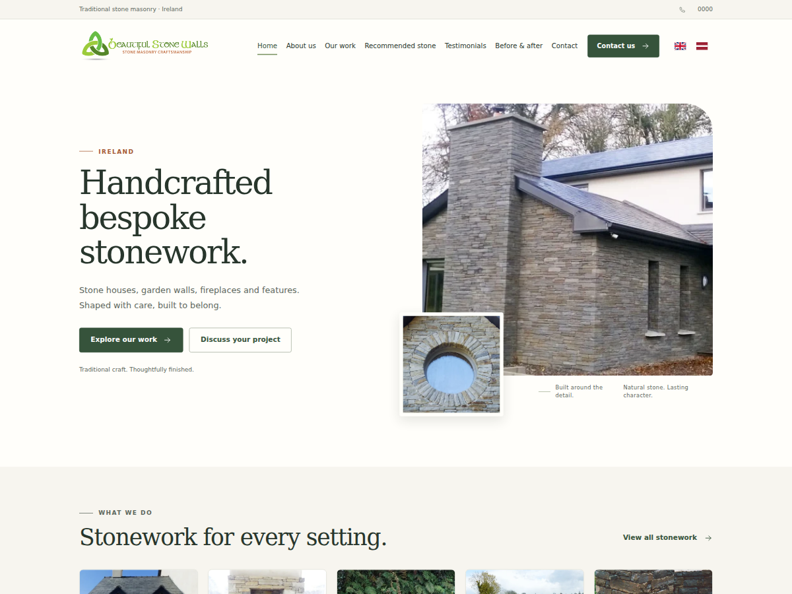

# Beautiful Stone Walls

**Version 1.2.0** · WordPress theme · Folder/text domain: `beautiful-stone-walls`

A responsive English/Latvian stonework portfolio using native WordPress pages,
posts, categories, media and the block editor. No page builder or build step is required.

[Repository](https://github.com/raivis-kalnins/wp-beautiful-stone-walls--theme)



## Package and dependencies

This is a complete, ordinary WordPress **theme ZIP** for installing or replacing
the theme on the existing bilingual site. It does not include a database, uploaded
project photographs, plugins, credentials or an UpdraftPlus backup.
Installing it on an empty WordPress site does not recreate the portfolio or translations.

| Component | Purpose |
| --- | --- |
| WordPress and PHP | Theme metadata declares WordPress 6.6+ and PHP 7.4+; installed plugins may require newer versions. |
| Existing site content | Native pages, project posts, categories, menus, attachment records and uploaded files. |
| [Polylang](https://wordpress.org/plugins/polylang/) | Bilingual content, translated menus and links to the matching page in the other language. |
| [Contact Form 7](https://wordpress.org/plugins/contact-form-7/) | The existing English and Latvian enquiry forms and their mail settings. |
| [Yoast SEO](https://wordpress.org/plugins/wordpress-seo/) | Optional integration for existing titles, descriptions, canonicals, social tags and organization schema. |

The theme does not install or configure these plugins automatically. Keep Polylang
and Contact Form 7 active on the bilingual site; preserve its existing content and media.

## Install or replace through WordPress Admin

1. Keep a current site backup, including the database and uploads.
2. Open **Appearance → Themes → Add New Theme → Upload Theme**.
3. Select `beautiful-stone-walls-1.2.0.zip` and choose **Install Now**.
4. If the theme is already installed, choose **Replace current with uploaded**.
   For a first installation, activate **Beautiful Stone Walls** after uploading.
5. Visit the WordPress dashboard as an administrator. This triggers the one-time
   1.2.0 contact update described below. Resolve any displayed update notice.
6. Clear hosting, plugin, CDN and browser caches, then check both languages.

Use the stable folder name `beautiful-stone-walls`. This update needs **no database
restore**. Upload the file as a theme, not as an UpdraftPlus restoration component.
No automatic GitHub updater is bundled; subsequent releases use the same manual replacement process.

## Changes in 1.2.0

- Plain English and Latvian flags, with no visible EN/LV text, circles or backgrounds.
  Accessible language labels, keyboard focus and 44-pixel tap targets remain.
- A visible header contact button in both languages: **Contact us** / **Sazināties**.
- Requested contact defaults: telephone `0000`, email `hello@dev4.click`,
  country **Ireland** for English and **Latvija** for Latvian.
- Optional website password protection under **Appearance → Site Privacy**.
- Retained centered SVG gallery plus icons, image/caption alignment and clean
  gallery gradients, including project, supplier and before/after galleries.
- Retained gallery filters, load-more controls and keyboard-accessible lightbox.
  Original image links and content remain usable without JavaScript.
- Retained responsive image sizes, priority loading for the main hero image,
  deferred theme JavaScript, system fonts and conditional Contact Form 7 assets.
- Included `screenshot.png` (1200 × 900), brand logo and fallback favicons.

## One-time contact update

The active theme runs a versioned `admin_init` migration when an administrator
next visits WordPress Admin. It sets the requested contact defaults once, clears
the old postal/service-area overrides and uses the language-specific countries.

The migration replaces known legacy contact/location wording only in the current
home, about and contact summaries, their English/Latvian translations, and their
associated Yoast title/description fields. It also replaces known old contact values
in the configured Contact Form 7 enquiry form and its translated counterpart.
Known legacy Yoast organization contact values are updated when Yoast is active.
Existing project records, historical project descriptions and review attributions stay intact.

If a required update cannot finish, an administrator notice explains the issue;
the migration can retry on a later admin visit. A checkpoint keeps a retry from
overwriting contact settings edited after the defaults were first applied.
See [`inc/contact-update.php`](inc/contact-update.php) for the exact scope.

## Edit content, countries and contact details

- **Pages / Posts:** select the appropriate language before editing content.
- **Appearance → Menus:** edit and assign the English and Latvian menus.
- **Appearance → Customize → Stone Walls · Contact & homepage:** edit telephone,
  email, countries, postal address, service area and homepage text after the migration.
  A blank address or service area displays the country for the current language.
- **Languages → Translations → Beautiful Stone Walls:** translate registered
  homepage text and review excerpts. Static interface translations use
  `languages/lv.po` and the compiled `languages/lv.mo`.
- **Contact → Contact Forms → [form] → Mail:** review each enquiry recipient.
  Later changes to the Customizer email do not automatically change form recipients.

Language URLs and translation relationships belong to Polylang and the database.
The existing setup uses English at the root and Latvian under `/lv/`; the theme
does not import content or reset that configuration when replaced.
The placeholder telephone `0000` is omitted from business telephone schema.

## Optional website password

Open **Appearance → Site Privacy** as an administrator.
On first use, protection is off and no password is set.

1. Set your own website password and enable **Require a password to view this website**.
2. Save the privacy settings. A password is required before protection can be enabled.
3. To keep the saved password later, leave the password field blank.
   Leading and trailing spaces are ignored; the saved password is never displayed.

Visitors who enter the correct password receive a signed browser cookie valid for
7 days. Changing the password or protection setting invalidates previous visitor access.
The stored password is hashed, and these settings survive theme ZIP replacements.
The website password is separate from WordPress account passwords.

The gate covers dynamic WordPress content routes, including pages, feeds and REST
content, with access retained for administrators and authenticated editing workflows.
The WordPress login and password-recovery screens remain reachable. Protection
works only while this theme is active. See [`inc/site-privacy.php`](inc/site-privacy.php).

**Caching and direct-file limits:** before enabling protection, disable or bypass
full-page caching and clear existing hosting, cache-plugin and CDN caches.
Responses already served upstream can bypass WordPress. The theme cannot protect
direct static uploads, image URLs or other files served by the web server.
Use hosting/server-level protection if those files must also be private.
Check the signed-out experience in a private browser after changing these settings.

## SEO, images and branding

Yoast remains responsible for its metadata; the theme extends its existing
organization schema instead of adding a competing graph. Edit per-page SEO fields
in Yoast and language relationships in Polylang. Search visibility follows WordPress
settings; theme installation does not enable indexing. Privacy mode additionally
requests no indexing and no caching for protected WordPress responses.

Native attachment records provide responsive image sources. The main hero loads
eagerly; other photographs use appropriate lazy loading. Uploaded originals stay
outside the theme package. A custom WordPress **Site Icon** takes precedence over
the included fallback favicon; browser caches may temporarily show the old icon.

## Repository layout and release ZIP

Keep theme files directly at the Git repository root: `style.css`, `functions.php`,
`header.php`, template files, `assets/`, `inc/`, `languages/`, `screenshot.png` and
these readmes. Do not add a second nested `beautiful-stone-walls/` directory.
Keep databases, uploads, local configuration and credentials outside this repository.

Review and commit changes, including the version in `style.css` and any rebuilt
translation catalog, before packaging. From the repository root run:

```sh
git status --short
git archive --format=zip --prefix=beautiful-stone-walls/ --output=../beautiful-stone-walls-1.2.0.zip HEAD
```

`git archive` includes committed files from `HEAD`; uncommitted changes are excluded.
The prefix creates the single folder WordPress needs. Keep that prefix unchanged
for later versions and update the ZIP filename. Upload the resulting ZIP through
WordPress Admin using the replacement steps above.

## License

Theme code: [GNU General Public License v2 or later](https://www.gnu.org/licenses/gpl-2.0.html).
